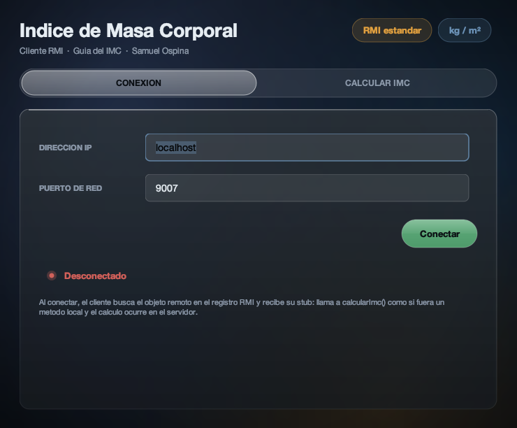
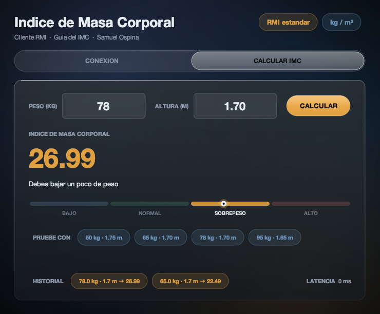
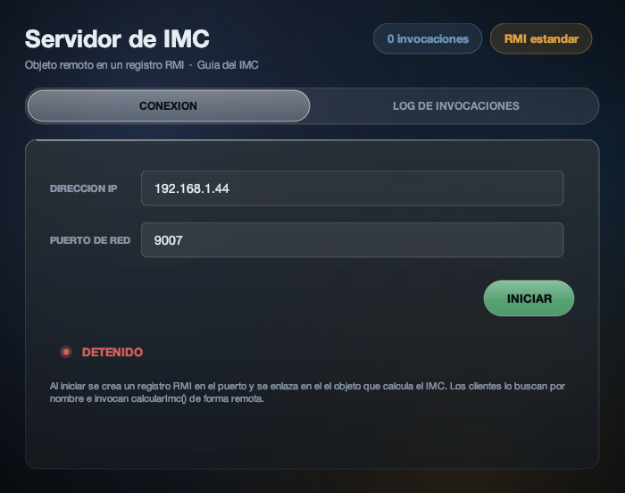
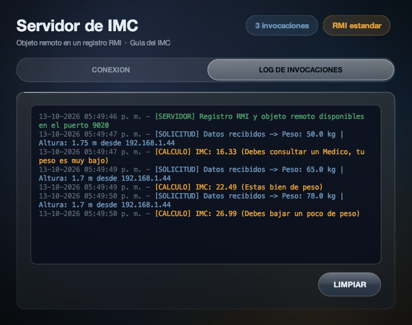

# Guía — Cálculo del IMC con RMI estándar de Java (sin librería)

Autor: **Samuel David Ospina De Avila**

Materia: Sistemas Distribuidos — profesor John Carlos Arrieta Arrieta

El ejemplo del IMC de la **"Guía de desarrollo de aplicaciones distribuidas usando RMI"** del profesor, rehecho con **RMI estándar de Java SE** (`java.rmi`), **sin librerías de terceros**: es el punto 2 de la guía. La versión con la librería LipeRMI está en [LipeRMI-IMC](https://github.com/SamuelOsp/LipeRMI-IMC); cliente, servidor e interfaz gráfica son los mismos y solo cambia la capa de invocación remota. Mi ejercicio de parcial (conversión de temperatura) con esta misma tecnología está en [RMI-Temperatura](https://github.com/SamuelOsp/RMI-Temperatura).

## Vistas

<table>
<tr>
<td width="50%">

**Cliente** — pestaña de conexión



</td>
<td width="50%">

**Cliente** — resultado de la invocación remota



</td>
</tr>
<tr>
<td width="50%">

**Servidor** — pestaña de conexión



</td>
<td width="50%">

**Servidor** — log de invocaciones atendidas



</td>
</tr>
</table>

## El ejercicio

El cliente pide el **peso** (kg) y la **altura** (m) e invoca de forma remota
`calcularImc(DatosImc)`. El servidor calcula `IMC = peso / altura²` y devuelve el mismo
objeto con el resultado y su interpretación. La fórmula y los rangos viven **únicamente en el
servidor**.

Se respetan los nombres de la guía (`DatosImc`, `IRemotaCalculoImc`, `CalculoRmiImcImplem`,
`Servidor`, `VentanaPrincipal`, puerto `9007`); el paquete base es `samuelospina.imc`.

Son tres proyectos, como en la guía:

| Proyecto | Tipo | Contenido |
|---|---|---|
| `LibImc` | Java Class Library | `DatosImc` (datos serializables) e `IRemotaCalculoImc` (interfaz remota). Lo usan los otros dos. |
| `ServidorTcpImc` | Java Application | `CalculoRmiImcImplem` (la lógica), `Servidor` (publica el objeto remoto) y la ventana con el log. |
| `ClienteTcpImc` | Java Application | Ventana Swing que valida los datos e invoca `calcularImc()` de forma remota. |

## Estructura

```
RMI-IMC/
├── LibImc/src/samuelospina/imc/rmi/lib/
│   ├── DatosImc.java
│   └── IRemotaCalculoImc.java
├── ServidorTcpImc/src/samuelospina/imc/
│   ├── Principal.java
│   ├── servidor/CalculoRmiImcImplem.java
│   ├── servidor/Servidor.java
│   ├── vistas/VentanaPrincipal.java
│   └── vistas/Glass.java
├── ClienteTcpImc/src/samuelospina/imc/cliente/
│   ├── Principal.java
│   ├── vistas/VentanaPrincipal.java
│   └── vistas/Glass.java
└── docs/screenshots/
```

Cada proyecto trae además `build.xml` y `nbproject/` para abrirlo en NetBeans.

## Abrir en NetBeans

1. `File > Open Project` y abrir las tres carpetas: `LibImc`, `ServidorTcpImc` y `ClienteTcpImc`.
2. Clic derecho sobre **LibImc** → *Clean and Build* (genera `LibImc/dist/LibImc.jar`).
3. *Run* sobre **ServidorTcpImc** y luego *Run* sobre **ClienteTcpImc**.

`ServidorTcpImc` y `ClienteTcpImc` tienen a `LibImc` agregado como proyecto (*Libraries > Add Project*), así
que NetBeans lo recompila solo cuando hace falta. NetBeans regenera
`nbproject/build-impl.xml` al abrir cada proyecto.

> Si NetBeans no reconoce algún proyecto, se puede crear con
> `File > New Project > Java with Ant > Java Project with Existing Sources` apuntando a su
> carpeta `src` y agregando los JAR en *Libraries*.

## Compilar y ejecutar por consola

Requiere solo un JDK 8 o superior (probado con JDK 21). Desde la raíz del repositorio:

```bash
# 1. Librería compartida
cd LibImc
javac -encoding UTF-8 -d build/classes $(find src -name "*.java")
mkdir -p dist && jar cf dist/LibImc.jar -C build/classes .

# 2. Servidor
cd ../ServidorTcpImc
javac -encoding UTF-8 -cp "../LibImc/dist/LibImc.jar" -d build/classes $(find src -name "*.java")
java -cp "../LibImc/dist/LibImc.jar:build/classes" samuelospina.imc.Principal

# 3. Cliente (en otra terminal)
cd ClienteTcpImc
javac -encoding UTF-8 -cp "../LibImc/dist/LibImc.jar" -d build/classes $(find src -name "*.java")
java -cp "../LibImc/dist/LibImc.jar:build/classes" samuelospina.imc.cliente.Principal
```

> En Windows el separador del classpath es `;` en lugar de `:`. El `-encoding UTF-8` importa
> porque los textos usan símbolos como `°`, `·` y `²`.

## Cómo probar

1. Ejecutar el **Servidor**, pestaña CONEXION, puerto `9007`, botón **INICIAR**.
2. Ejecutar el **Cliente**, IP `localhost` (o la IP que muestra el servidor), puerto `9007`,
   botón **Conectar**.
3. En la pestaña **CALCULAR IMC** escribir peso y altura y pulsar **CALCULAR** (o Enter).
4. El IMC y su interpretación aparecen en el cliente, con el medidor y el historial, y la
   traza queda en la pestaña **LOG DE INVOCACIONES** del servidor.

| Peso (kg) | Altura (m) | IMC | Interpretación |
|---|---|---|---|
| `50` | `1.75` | `16.33` | Debes consultar un Medico, tu peso es muy bajo |
| `65` | `1.70` | `22.49` | Estas bien de peso |
| `78` | `1.70` | `26.99` | Debes bajar un poco de peso |
| `95` | `1.65` | `34.89` | Debes consultar un Medico, tu peso es muy alto |
| `0` | `1.70` | — | ERROR: El peso y la altura deben ser mayores que 0 |

Los rangos son los de la guía: menor que 18.5, de 18.5 a 24.9, de 24.9 a 29.9 y mayor.

## Validación y control de errores

En el **cliente**, antes de invocar al servidor: campos vacíos, texto no numérico (se acepta
coma o punto decimal), valores menores o iguales a cero, altura escrita en centímetros
(mayor a 3), puerto no numérico, e intento de calcular sin conexión. Si la invocación falla
porque el servidor se cayó, el cliente avisa y vuelve a "Desconectado" sin cerrarse.

En el **servidor**, `CalculoRmiImcImplem` vuelve a validar que peso y altura sean mayores
que 0, como en la guía.

## Interfaz

Las dos ventanas usan mi kit visual `vistas/Glass.java` (material translúcido tipo *Liquid
Glass*, pintado a mano con Java2D y sin librerías externas), el mismo de la entrega con
Sockets TCP. Para esta entrega el kit creció con:

- **`Glass.Medidor`**: escala por tramos con un marcador animado que se desliza hasta el
  resultado e ilumina el tramo que corresponde.
- **`Glass.Bitacora`**: consola del servidor que colorea cada línea según su etiqueta
  (`[SERVIDOR]`, `[CONEXION]`, `[SOLICITUD]`, `[CALCULO]`, `[ERROR]`).
- **Historial** de las últimas invocaciones y **latencia** en milisegundos de la llamada
  remota en el cliente; **contador de invocaciones** atendidas en el servidor.
- El servidor muestra la IPv4 de la red local (no `127.0.0.1`), que es la que debe escribir
  un cliente en otro computador.

## RMI estándar vs LipeRMI: diferencias y similitudes

| | RMI estándar (Java SE) | LipeRMI |
|---|---|---|
| Dependencias | Ninguna: viene en el JDK (`java.rmi`) | `lipermi-1.0.1.jar` en cliente y servidor |
| Interfaz remota | Debe extender `java.rmi.Remote` | Interfaz Java común |
| Métodos remotos | Cada uno declara `throws RemoteException` | Sin excepciones obligatorias |
| Implementación | Extiende `UnicastRemoteObject`; el constructor declara `RemoteException` | Clase común (POJO) que implementa la interfaz |
| Publicar en el servidor | `LocateRegistry.createRegistry(puerto)` + `registro.rebind(nombre, objeto)` | `CallHandler.registerGlobal(Interfaz.class, objeto)` + `Server.bind(puerto, handler)` |
| Cómo lo encuentra el cliente | Por **nombre** en el registro: `LocateRegistry.getRegistry(ip, puerto).lookup(nombre)` | Por **tipo**: `new Client(ip, puerto, handler).getGlobal(Interfaz.class)` |
| Conexión | No hay conexión visible: el stub abre y reutiliza sockets por su cuenta | Un socket TCP persistente por cliente, que se abre y se cierra explícitamente |
| Detener el servidor | `unbind` + `unexportObject` del objeto y del registro | `Server.close()` (ver nota abajo) |
| Dirección del servidor | Viaja dentro del stub (`java.rmi.server.hostname`) | El cliente usa la IP y el puerto que escribió |
| Errores de red en el cliente | `RemoteException` comprobada | Excepción no comprobada lanzada por el proxy |

**Similitudes:** en los dos casos el cliente llama a un método sobre un *proxy* de la interfaz
como si el objeto fuera local; los parámetros y el resultado deben ser `Serializable` y viajan
por valor sobre TCP; la interfaz y la clase de datos se comparten entre cliente y servidor
mediante el mismo JAR de librería; y el cálculo se ejecuta únicamente en el servidor.

## Decisiones propias del RMI estándar

- **Registro embebido.** `Servidor.iniciar()` crea el registro con
  `LocateRegistry.createRegistry(puerto)`; no hay que ejecutar el comando `rmiregistry`.
- **Un solo puerto.** El objeto remoto se exporta en el mismo puerto del registro
  (`super(puerto)` en `UnicastRemoteObject`), así el servicio completo usa un único puerto TCP.
- **Detener libera el puerto.** `detener()` hace `unbind` y luego `unexportObject` del objeto
  **y del registro**; cuando no queda nada exportado, Java cierra el socket de escucha. Por eso
  se puede detener y volver a iniciar en el mismo puerto sin reiniciar la aplicación.
- **IP que anuncia el stub.** El stub que recibe el cliente lleva adentro la dirección del
  servidor. Antes de exportar se fija `java.rmi.server.hostname` con la IP de red local que
  muestra la ventana; sin eso Java puede anunciar `127.0.0.1` y un cliente en otro computador
  encontraría el registro pero fallaría al invocar el método.
- **Quién llama.** El log muestra la IP del cliente con `getClientHost()`.
